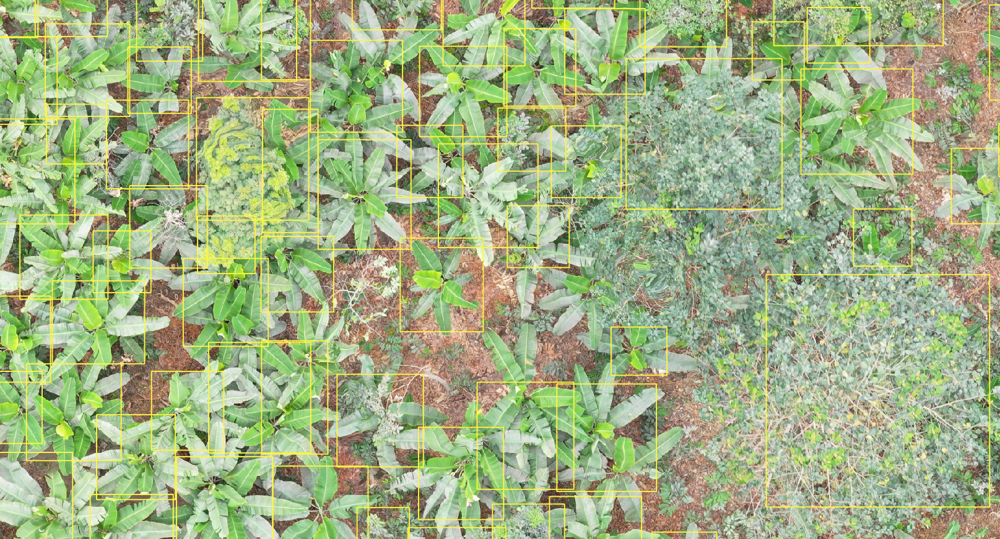
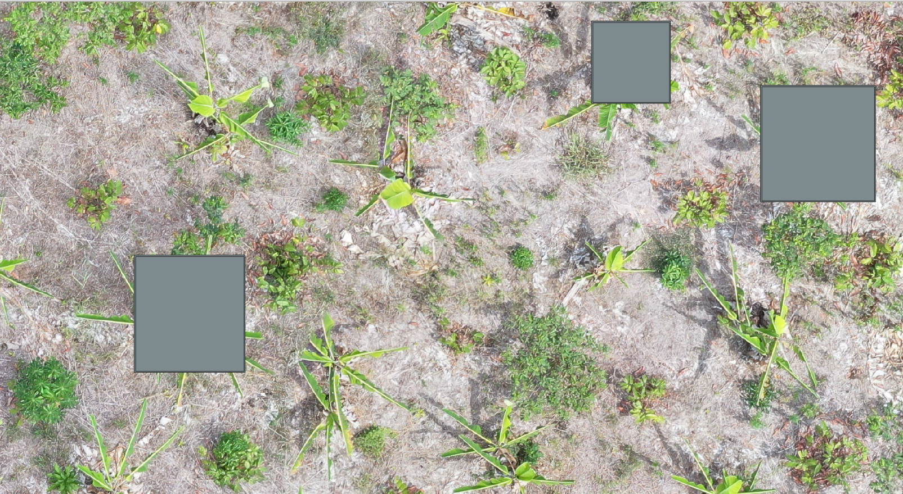
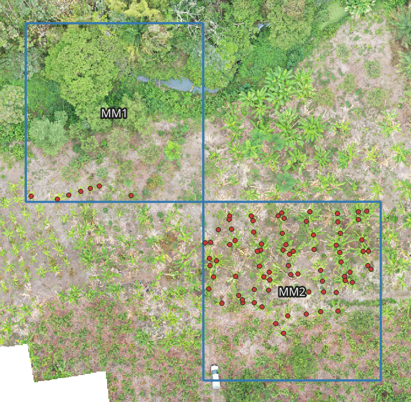

# Carnet de données

Brouillon du 25 octobre 2026, mis à jour le 27 octobre 2026 avec les images Sentinel-2, les parcelles des deux sites, le masque de nuages, le script de calcul des indices et ses premiers résultats, puis la détection d'anomalies de vigueur et de stress hydrique, et le jeu de drone ReforesTree pour le comptage des pieds (et, avant, les vérifications de BananaLSD). Tout ce qui est marqué **à vérifier** n'a pas encore été contrôlé sur la source. Ce carnet se complète au fil du projet.

## Règles du sujet

- Uniquement des sources publiques dont la licence autorise l'usage.
- Pour chaque source : provenance, licence, résolution, date d'acquisition, découpage entraînement/validation/test, risques de fuite.
- Découpage par parcelle, par site ou par pays, jamais aléatoire. Toute fuite entre entraînement et test disqualifie.

## Vue d'ensemble

| Jeu | Contenu | Pays | Usage prévu | Licence |
| --- | --- | --- | --- | --- |
| Banana leaves and stem, Tanzanie (Lacuna) | 16 092 ou 17 068 images de feuilles et de tiges (à compter) | Tanzanie | Maladies | CC BY (à confirmer sur Dataverse) |
| Banana Leaves Imagery Dataset (2022-2023) | 11 767 images de feuilles | Tanzanie | Maladies (validation) | CC BY 4.0 (Zenodo) |
| BananaLSD | 937 images brutes (897 après exclusions) | Bangladesh | Maladies, test d'un autre pays | à vérifier |
| Remote Sensing applications for Banana Crops | Images de drone multispectrales | Australie | Vigueur, comptage, suivi temporel | à vérifier |
| Sentinel-2 L2A (Copernicus Browser) | 4 scènes de 10 bandes (2 dates par site), résolution environ 10 m | Équateur, Côte d'Ivoire | Vigueur, stress hydrique, suivi temporel | Copernicus, accès libre et ouvert (à vérifier) |
| ReforesTree (Zenodo) | 6 orthomosaïques de drone RGB à environ 1 cm/pixel, 7 969 couronnes annotées dont 3 436 bananiers | Équateur | Comptage des pieds | CC BY 4.0 |

## Photos de feuilles (module maladies)

Ces images sont prises au sol et de près, au smartphone, pas par drone. Cet écart est à documenter dans le rapport.

### 1. Banana leaves and stem images, Tanzanie (projet Lacuna)

- **Provenance** : Nelson Mandela African Institution of Science and Technology et Tanzania Agricultural Research Institute (TARI), financé par le Lacuna Fund ; maintenu par le Makerere AI Lab. Dépôt Harvard Dataverse, doi 10.7910/DVN/LQUWXW. Article de données (Mduma et Leo, 2023) et fiche technique `Bananas_TZ_data_sheet.pdf` (2022).
- **Contenu** : trois classes : saine, cercosporiose noire (Black Sigatoka), fusariose « Race 1 ». Des photos de **feuilles et de tiges** (la fiche montre la fusariose en coupe de pseudo-tronc).
- **Effectifs** : la fiche technique annonce 17 068 images (5 883 saines, 6 147 Black Sigatoka, 5 038 fusariose) ; l'article de 2023 et le sujet citent 16 092 (5 628 / 5 767 / 4 697). **Écart à résoudre en comptant les fichiers téléchargés.**
- **Fichiers** (7, environ 7,7 Go) : `BLACK SIGATOKA_1.zip` (1,5 Go), `BLACK SIGATOKA_2.zip` (1,7 Go), `FUSARIUM WILT_1.zip` (1,1 Go), `FUSARIUM WILT_2.zip` (1,0 Go), `HEALTHY_1.zip` (1,0 Go), `HEALTHY_2.zip` (1,4 Go), plus la fiche technique en PDF (856 Ko). Dates de publication des fichiers entre juillet 2022 et avril 2023.
- **Acquisition** : smartphones Samsung avec l'application AdSurv (collecte participative), dans des jardins de fermiers, de février à juillet 2021, dans cinq régions : Arusha, Kilimanjaro, Kagera, Dar es Salaam, Mbeya.
- **Résolution** : non indiquée dans la fiche ; mesurée sur `HEALTHY_1` : côté long de 1 024 pixels au maximum, 190 à 270 Ko par image (voir les vérifications ci-dessous).
- **Licence** : CC BY d'après la fiche technique (citation des créateurs obligatoire). **À confirmer sur la page Dataverse** (rubrique « Terms »), car la licence affichée en ligne peut différer.
- **Annotations** : une étiquette de classe par image ; les images sont aussi annotées pour la détection et la segmentation selon la fiche (à vérifier dans les archives).
- **Découpage** : aucun fourni. **Pas d'identifiant de ferme ni de région par image**, selon la fiche : à chercher dans les noms de fichiers et les métadonnées EXIF.
- **Doublons** : les auteurs disent avoir retiré les doublons identifiés, mais qu'un petit nombre peut subsister, et que le jeu contient des images « extrêmement similaires » sans être des doublons. À vérifier avec `find_duplicates.py` et `make_exclusions.py`.
- **Usage prévu** : entraînement et validation du module maladies, après séparation des feuilles et des tiges.

**Vérifications faites le 26 octobre 2026 sur `HEALTHY_1.zip` (campagne 2021)**

| Vérification | Résultat |
| --- | --- |
| Intégrité du zip | MD5 cohérent avec la page Dataverse (début et fin comparés : `1b1…3bf`) |
| Contenu | 2 860 images JPEG, plus un fichier `.DS_Store` ; aucune image illisible ; un seul sous-dossier `HEALTHY_1`, noms `Image_N.jpg` |
| Tailles | 8 tailles : 768×1024 (921), 1024×768 (775), 640×288 (407), 288×640 (340), 480×640 (170), 460×1024 (132), 1024×460 (96), 640×480 (19) |
| Trois styles de prise de vue (échantillon de 4 images par taille) | gros plans du limbe en 4:3 (environ 59 %), bandes recadrées de rapport environ 9:20 (environ 34 %), feuilles entières avec fond (environ 7 %) |
| Métadonnées EXIF | uniquement sur les 1 695 images en 4:3 (59 %) : un seul téléphone, Samsung SM-A015F ; les 1 165 autres images n'ont aucune métadonnée |
| Dates | du 18 au 25 mars 2021, 6 jours distincts, dont 97 % des images datées les 18 et 19 mars |
| GPS | 922 images avec coordonnées, toutes dans un même carré de 0,1 degré (environ 11 km) ; 83 % dans un même carré d'environ 100 m |
| Sessions de prise de vue | 12 sessions avec un écart de 30 minutes (744, 522, 371, 49, 2 images, plus 7 images isolées) : trop grosses pour servir de groupes |
| Numérotation | pour les images datées, 99 % des numéros consécutifs ont été pris à moins de 10 minutes d'écart : la numérotation suit l'ordre de prise de vue |
| Doublons | pas encore vérifiés |

Constat : la partie datée de ce lot vient d'un seul téléphone, de deux jours de collecte et d'un secteur très restreint. La diversité annoncée dans la fiche technique (cinq régions, de février à juillet) n'apparaît pas dans ce zip.

### 2. Banana Leaves Imagery Dataset (campagne 2022-2023, publiée en 2025)

- **Provenance** : Mduma et Elinisa, *Scientific Data* 2025, 12:477 (doi 10.1038/s41597-025-04456-4). Données déposées sur Zenodo, doi 10.5281/zenodo.7670326, publiées le 23 février 2023. Équipe de NM-AIST (Tanzanie), avec le soutien de la SIDA, de l'IDRC et d'AI4D Africa.
- **Contenu** : 11 767 images de feuilles : 3 339 saines, 3 496 Black Sigatoka, 4 932 fusariose « Race 1 ».
- **Acquisition** : du 22 novembre 2022 au 13 janvier 2023, dans 51 fermes tirées au hasard de quatre districts : Rungwe (14), Mbeya (11), Arumeru (12), Arusha (14). Smartphone Samsung SM-A715F/DS, outil Open Data Kit, collecte par des fermiers et des chercheurs sous la supervision de l'IITA et de NM-AIST. Objectif déclaré : couvrir une saison de culture absente du jeu de 2021.
- **Prétraitement** : images recadrées à la main pour retirer le fond ; doublons retirés avec VisiPics (images strictement identiques) et Duplicate Photo Finder (filtre « même image ») ; renommage `HEALTHY_105.jpg`, etc. Les noms d'origine portaient l'heure de prise de vue (`20221122_085908.jpg` dans la figure 3 de l'article).
- **Fichiers** : 9 zips, 34,3 Go au total, avec les sommes MD5 publiées sur Zenodo :

| Fichier | Taille | MD5 |
| --- | --- | --- |
| `BLACK SIGATOKA-1.zip` | 3,7 Go | 6b0fef13f54a8e375fc32318f3d5b4aa |
| `BLACK SIGATOKA-2.zip` | 3,3 Go | 216b72db76bb22229fa48e1acf266100 |
| `BLACK SIGATOKA-3.zip` | 5,1 Go | aae94003eaadd3a0ce5cb1bbcacf9bbe |
| `FUSARIUM WILT-1.zip` | 3,1 Go | 3ef5c0ffd68c22514b904314bfb96924 |
| `FUSARIUM WILT-2.zip` | 5,0 Go | 88409a37eb8365d5fd298f494c55bc6a |
| `FUSARIUM WILT-3.zip` | 7,2 Go | 90978e4cc33c9be8604eab376e84c8ce |
| `HEALTHY-1.zip` | 2,0 Go | d19fc229988d0e0e9eb26d0ae7c593f8 |
| `HEALTHY-2.zip` | 2,3 Go | 9fd64b757a161253b16e165b90ddf7f5 |
| `HEALTHY-3.zip` | 2,6 Go | 787d4f02b9b3d7e831e85d82ac757670 |

  Attention : ces noms (avec un tiret, `HEALTHY-1.zip`) ressemblent à ceux du jeu 2021 (avec un tiret bas, `HEALTHY_1.zip`) : ne pas les mélanger dans les dossiers.
- **Résolution** : l'article annonce 3480 × 3496 pixels ; mesuré sur `HEALTHY-1`, une seule image sur 1 000 a cette taille (voir ci-dessous).
- **Annotations** : étiquettes de classe ; polygones LabelMe pour la segmentation (instances et sémantique), selon l'article.
- **Licence** : CC BY 4.0, lue sur la page Zenodo du dépôt le 26 octobre 2026 (l'article est aussi en CC BY 4.0). Citation obligatoire : Mduma, N., & Elinisa, C. (2023). *Banana Imagery Dataset - Tanzania* [Dataset]. Zenodo. https://doi.org/10.5281/zenodo.7670326
- **Description Zenodo** : jeu créé pour la classification d'images et la détection d'objets ; version unique (v1), créé et modifié les 25 février 2023.
- **Usage prévu** : validation du module maladies (autre saison que l'entraînement).
- **Réserves** : le dépôt Zenodo date du 23 février 2023, alors que le tableau 1 de l'article place le prétraitement (nettoyage, recadrage, renommage) de février à mars 2023 : le dépôt n'est peut-être pas la version finale (à vérifier sur les fichiers) ; mêmes pays, même équipe et mêmes classes que le jeu de 2021 ; les deux campagnes couvrent toutes deux les régions d'Arusha et de Mbeya, donc des fermes ont pu être photographiées dans les deux (à vérifier). La séparation 2021 / 2022-2023 est surtout une séparation dans le temps. Doublons possibles entre les deux jeux : à vérifier par empreinte visuelle.

**Vérifications faites le 26 octobre 2026 sur `HEALTHY-1.zip` (campagne 2022-2023)**

| Vérification | Résultat |
| --- | --- |
| Intégrité du zip | MD5 identique à celui de Zenodo (d19fc229988d0e0e9eb26d0ae7c593f8), 1 987 887 676 octets |
| Contenu | 1 002 fichiers dont 1 000 images lisibles, aucune illisible (nature des 2 autres fichiers à identifier) |
| Tailles | 759 tailles distinctes ; la plus fréquente est 4624×3468 (46 images, probablement la photo complète) ; environ 2 Mo par fichier |
| Orientation | 457 en paysage, 485 en portrait, 58 à peu près carrées (rapport largeur/hauteur entre 0,95 et 1,05) |
| Rapport largeur/hauteur | min 0,25 ; 10 % 0,62 ; médiane 0,98 ; 90 % 1,47 ; max 4,26 |
| Mégapixels | min 3,7 ; médiane 12,6 ; max 16,0 |
| Plus grand côté | min 2 584 ; médiane 3 981 ; max 4 624 pixels |
| Métadonnées EXIF | marque et modèle sur 1 000 images : Samsung SM-A715F (comme dans l'article) ; date sur 181 images seulement (52 en novembre 2022, 129 en janvier 2023) ; aucune coordonnée GPS (21 balises GPS vides) |
| Contenu visuel (échantillon de 36 images) | feuilles entières ou grandes parties de feuilles, avec fond visible (sol, paille, tuyaux d'irrigation, autres bananiers) |
| Étiquettes à contrôler | plusieurs images étiquetées « saines » montrent de petites marques brunes (stries, taches) ; cause inconnue (sénescence, dégât, début de maladie) |
| Doublons | pas encore vérifiés |

Constat : les images sont en haute résolution (3,7 à 16 mégapixels), très variables en taille et en proportion, avec un fond visible. Elles diffèrent beaucoup de la campagne 2021 (côté long de 1 024 pixels maximum, gros plans sans fond ou bandes recadrées).

### 3. BananaLSD

- **Provenance** : Arman et al., *Data in Brief* 50 (2023), 109608 ; données sur Mendeley Data (doi 10.17632/9tb7k297ff.1).
- **Contenu** : 937 images brutes en 4 classes (saine, Sigatoka, Cordana, Pestalotiopsis), plus une version augmentée de 1 600 images (400 par classe). Dans l'archive : `BananaLSD/OriginalSet` et `BananaLSD/AugmentedSet`, chacun avec un dossier par classe.
- **Acquisition** : trois smartphones, juin 2021, champs de l'université BSMRAU et alentours (Gazipur, Bangladesh).
- **Annotations** : une étiquette par image, posée par un phytopathologiste. La classe « Sigatoka » regroupe la cercosporiose noire et la jaune.
- **Licence** : à vérifier sur la page Mendeley. L'article est en CC BY 4.0, mais ce n'est pas forcément la licence du jeu.
- **Usage prévu** : test uniquement, sur le dossier `OriginalSet` (autre pays par rapport aux jeux tanzaniens). Le dossier `AugmentedSet` n'est jamais utilisé.

**Vérifications faites le 25 octobre 2026 sur `OriginalSet`**

| Vérification | Résultat |
| --- | --- |
| Effectifs par classe | Conformes à l'article : Cordana 162, saines 129, Pestalotiopsis 173, Sigatoka 473 (total 937) |
| Format et taille | 937 JPEG, tous en 224 × 224 pixels (images redimensionnées par les auteurs) |
| Fichiers illisibles | Aucun |
| Avertissements Pillow | « malformed MPO file » et « Tag data larger than file » sur des images de Sigatoka : métadonnées de smartphone anormales, images lues normalement |
| Copies exactes (même fichier, SHA-256) | 38, toutes dans la classe saine |
| Même fichier dans deux classes | 1 : `healthy/122.jpeg` et `pestalotiopsis/78.jpeg`, étiquette contradictoire |

**Effectifs nets après exclusions** (liste dans `out/exclusions.csv`, aucun fichier supprimé) :

| Classe | Brut | Net |
| --- | --- | --- |
| Cordana | 162 | 162 |
| Saine | 129 | 90 |
| Pestalotiopsis | 173 | 172 |
| Sigatoka | 473 | 473 |
| Total | 937 | 897 |

**Constats visuels** (planche de 16 images, échantillon à confirmer) : feuilles photographiées de près, au sol, avec des fonds variables ; certaines images de Sigatoka sont grisâtres, à regarder de plus près.

## Images aériennes

### 4. Remote Sensing applications for Banana Crops (Université de New England, Australie)

- **Provenance** : Aeberli, Robson, Lamb, Johansen et Phinn, jeu publié le 10 novembre 2022 (handle 1959.11/56246).
- **Contenu** : images de drone d'une caméra multispectrale Parrot Sequoia sur 22 campagnes de vol, plus des données hyperspectrales pour le suivi des acariens.
- **Intérêt** : détection de couronnes dans des plantations aux âges mélangés, suivi temporel.
- **Résolution, bandes, annotations, licence** : à vérifier.
- **Lien avec le sujet** : le jeu n'est pas cité dans le sujet. Il a été trouvé par recherche web. Le sujet cite l'article « Détection de bananiers sur images drone multispectrales multi-dates » (*Remote Sensing* 2021, doi 10.3390/rs13112123), dont les auteurs (Aeberli, Johansen, Robson, Lamb, Phinn) et le thème sont les mêmes que ceux de ce jeu ; la fiche du jeu ne cite toutefois pas l'article, donc le lien exact est à confirmer.
- **Accès** : la fiche (https://hdl.handle.net/1959.11/56246, doi 10.25952/jjjx-q835) annonce des fichiers .tiff, .txt et .zip, mais le tableau de fichiers était vide à la lecture : liste, tailles et licence à relever dans le navigateur. Contact indiqué sur la fiche : Aaron Aeberli.
- **Accès, vérification du 28 octobre 2026** : le tableau de fichiers de la fiche de l'université est toujours vide, et la notice de Research Data Australia indique « Record deleted ». Aucun lien de téléchargement public trouvé : jeu **non utilisable** en l'état, sauf réponse de l'auteur.
- **Repère de performance** : l'article de 2021 rapporte, pour la détection de pieds, un F-score de 0,85 à 0,93 selon les dates pour un réseau convolutif, 0,74 à 0,86 pour le template matching et 0,73 à 0,86 pour le filtre de maximum local. Leur définition du F-score peut différer de celle du sujet (appariement à 1 m).

### 5. Sentinel-2 L2A (Équateur et Côte d'Ivoire)

#### Source et export

- **Provenance** : Copernicus Browser (Sentinel Hub), produit Sentinel-2 niveau L2A.
- **Licence** : données Copernicus Sentinel, accès libre et ouvert. **À vérifier** sur la page officielle, et reproduire la mention d'attribution exigée.
- **Export** : onglet « Analytical », TIFF 32 bits flottants, résolution HIGH, option « Clip extra bands » **désactivée**.
- **Contenu par scène** : B02, B03, B04, B05, B06, B07, B08, B8A, B11, B12 (valeurs brutes), image couleur naturelle, carte de classification de scène (SCL) en version colorée.
- **Résolution obtenue** : 9,98 m par pixel (Équateur), 9,95 m (Côte d'Ivoire).
- **Valeurs** : réflectance de surface, non écrêtée. Des valeurs supérieures à 1 existent (nuages brillants, Côte d'Ivoire, juin 2023).
- **Résolution native des bandes** : B02, B03, B04, B08 à 10 m ; B05, B06, B07, B8A, B11, B12 à 20 m, rééchantillonnées à environ 10 m par l'export. À vérifier dans la documentation Sentinel-2.
- **Limite** : à 10 m par pixel, on ne peut pas compter des pieds, seulement cartographier des zones.

#### Sites et dates

| Site | Dates | Emprise (m) | CRS | Taille |
| --- | --- | --- | --- | --- |
| Équateur (El Retiro / Troncal de la Costa, centre de l'image : −3,373 ; −79,888) | 10/02/2023 et 29/08/2023 | x 621 482 à 625 494, y 9 625 933 à 9 628 325 | EPSG:32717 | 402 × 242 px (≈ 4,0 × 2,4 km) |
| Côte d'Ivoire (fleuve Bandama, près d'Aoua, centre de l'image : 5,812 ; −4,837) | 13/06/2023 et 04/01/2024 | x 292 602 à 300 603, y 640 323 à 645 076 | EPSG:32630 | 804 × 483 px (≈ 8,0 × 4,8 km) |

- Pour chaque site, les deux dates ont **exactement la même emprise et la même grille** : la comparaison temporelle est directe.
- Saisons : février 2023 (Équateur) et juin 2023 (Côte d'Ivoire) correspondent probablement à la saison des pluies, août 2023 et janvier 2024 à la saison sèche. **À vérifier** avec des données climatiques.
- Une première série de zips a été supprimée et remplacée : l'emprise a un peu changé (environ 350 m en Équateur, 550 m en Côte d'Ivoire). Seule la seconde série est utilisée.
- **Culture non confirmée en Côte d'Ivoire** : rien ne prouve encore que les blocs sont des bananiers (palmier à huile ou hévéa possibles). À vérifier avant toute interprétation agronomique.

#### Parcelles

| Site | Parcelles | Méthode | Fichier | État |
| --- | --- | --- | --- | --- |
| Côte d'Ivoire | 33 | Tracé manuel dans QGIS sur l'image couleur du 04/01/2024, accrochage activé, GeoPackage exporté en GeoJSON | `parcelles_cotedivoire.geojson` (EPSG:32630) | Terminé |
| Équateur | 13 | Tracé manuel dans QGIS sur l'image couleur du 10/02/2023 (essais en fausses couleurs et en proche infrarouge abandonnés, jugés moins lisibles), accrochage activé | `parcelles_equateur.geojson` (EPSG:32717) | Terminé |

Contrôles sur la Côte d'Ivoire : géométries toutes valides, aucun chevauchement, identifiants uniques, champ `site` rempli partout. Superficie totale 97 ha, de 0,9 à 6,1 ha par parcelle (médiane 2,8 ha). Après un rétrécissement d'un pixel vers l'intérieur, la plus petite parcelle garde 57 pixels. Le champ `split` est vide : le découpage reste à décider.

Contrôles sur l'Équateur : 13 polygones valides, aucun chevauchement, identifiants uniques, champ `site` rempli partout (complété après coup pour P12 et P13). Superficie totale 82,6 ha, de 3,5 à 8,4 ha par parcelle (médiane 6,5 ha). Après rétrécissement d'un pixel, la plus petite parcelle garde 231 pixels. Une grille de petits carrés tracée au sud-ouest du bloc a été **écartée** : chaque carré n'aurait contenu que quelques pixels, donc des moyennes peu fiables.

Les fichiers de référence sont rangés dans `data/parcelles/` et ne doivent plus être modifiés.

#### Masque de nuages

La carte SCL téléchargée est une image colorée, pas les codes bruts. Ses couleurs correspondent exactement à la palette standard de Sentinel-2 et ont été reconverties en classes. Sont écartés : nuages (forte et moyenne probabilité), cirrus fins, ombres de nuages, pixels sombres. Les pourcentages sont calculés sur les pixels de la parcelle **après rétrécissement d'un pixel** (ceux qui servent réellement aux statistiques) ; un premier calcul avant rétrécissement donnait des valeurs un peu différentes (par exemple 15,3 % au lieu de 9,8 % pour P29 en juin, et 18 parcelles retenues au lieu de 17 à 70 % en janvier).

| Date | Parcelles avec au moins un pixel masqué | Pire parcelle |
| --- | --- | --- |
| 13/06/2023 | 3 sur 33 | 9,8 % (P29) |
| 04/01/2024 | 26 sur 33, dont 20 au-dessus de 30 % | 100 % (P04 à P10) |

**Équateur** : aucun nuage aux deux dates. La carte de classification ne contient que de la végétation et du sol nu, donc 0 % de pixels masqués sur les 13 parcelles. Le seuil de nuages n'y joue aucun rôle.

**Côte d'Ivoire** : janvier 2024 est voilé par des **cirrus fins**, alors que juin 2023, malgré de gros nuages sur la scène, est propre sur les parcelles. Le classement est automatique et peut se tromper.

**Effet mesuré des cirrus sur les indices** : un cirrus fin décale les réflectances, mais les indices normalisés semblent peu touchés à l'échelle de la parcelle. Deux constats :

- En janvier, les parcelles « fiables » et « non fiables » ont presque les mêmes moyennes (NDVI 0,762 contre 0,758 ; NDMI 0,357 contre 0,359).
- Dans 11 parcelles partiellement voilées (15 à 85 % de pixels sous cirrus), l'écart entre pixels voilés et non voilés d'une même parcelle est quasi nul en médiane (NDVI 0,000 ; NDRE +0,002 ; NDMI +0,008). Exception : P14 (environ −0,09 sur les trois indices).

Limites : 11 parcelles seulement, et l'écart peut aussi refléter des différences réelles de végétation entre les zones voilées et non voilées. Le seuil de 50 % reste un choix prudent ; l'ablation 30/50/70 % dira son effet sur les résultats.

#### Choix retenus pour le traitement des nuages

1. **Les 33 parcelles restent dans tous les résultats**, avec leur pourcentage de pixels masqués pour chaque date (colonnes `pct_masque` et `statut` de `parcelles_indices.csv`, produit par `indices_parcelles.py`).
2. **Le seuil est un paramètre de la chaîne** (par exemple `--seuil-nuage 50`), valeur par défaut 50 %. Au-delà, la parcelle est marquée « donnée non fiable » pour cette date, sans être supprimée.
3. Le seuil de 50 % est un **choix, pas une règle** : il retient une parcelle dont la moitié des pixels est propre et évite que des cirrus créent de fausses alertes de vigueur ou de stress.

| Seuil | Juin 2023 | Janvier 2024 | Retenues aux deux dates |
| --- | --- | --- | --- |
| 30 % | 33 / 33 | 13 / 33 | 13 |
| 50 % (défaut) | 33 / 33 | 16 / 33 | 16 |
| 70 % | 33 / 33 | 17 / 33 | 17 |

#### Calcul des indices par parcelle (`scripts/indices_parcelles.py`)

- **Commande** : `python scripts/indices_parcelles.py --images data/sentinel2/<site> --parcelles data/parcelles/parcelles_<site>.geojson --out out/<site>`. Le dossier d'images peut contenir les zips tels quels.
- **Indices** : NDVI = (B08 − B04) / (B08 + B04) ; NDRE = (B8A − B05) / (B8A + B05) ; NDMI = (B08 − B11) / (B08 + B11). Le choix de B8A pour le NDRE est à justifier ou à comparer à B08 dans le rapport.
- **Paramètres par défaut** : rétrécissement d'un pixel, seuil de nuages 50 %, 20 pixels minimum. Ils sont enregistrés dans `parametres.json` à chaque exécution.
- **Pixels exclus des statistiques** : classes masquées (nuages, cirrus, ombres, pixels sombres) et eau.
- **Statuts** : `ok`, `non_fiable` (masque au-dessus du seuil, statistiques calculées quand même), `insuffisant` (moins de 20 pixels utilisables), `trop_petite` (parcelle de moins de 20 pixels). Aucune parcelle n'est supprimée.
- **Sorties** : `parcelles_indices.csv` (une ligne par parcelle et par date, avec la scène source), `parcelles_indices.geojson`, cartes GeoTIFF des indices et du masque dans `cartes/`.
- **Vérification** : sur trois parcelles (P09 et P04 en Équateur, P23 en Côte d'Ivoire), le nombre de pixels et le NDVI moyen coïncident avec un calcul indépendant (test des centres de pixels avec shapely). Les mêmes résultats ont été obtenus sur l'ordinateur du projet.
- **Statuts obtenus** : Équateur, 13 `ok` aux deux dates. Côte d'Ivoire, 33 `ok` en juin 2023 ; 16 `ok` et 17 `non_fiable` en janvier 2024.

#### Premiers résultats (27 octobre 2026)

Aucune mesure de terrain ne permet de les valider : ce sont des constats à tester, pas des diagnostics.

- **Équateur, couvert dense et homogène** : NDVI moyen de 0,87 à 0,89, NDRE de 0,68 à 0,70. Les différences entre parcelles (écart-type 0,005 pour le NDVI) sont plus faibles que les variations à l'intérieur d'une parcelle (0,012) : on ne peut pas classer les parcelles. Le classement n'est pas stable entre février et août (corrélation de rang proche de 0, sur 13 parcelles seulement). Changement moyen entre les dates : NDVI −0,006, NDMI −0,018.
- **Équateur, NDMI peu informatif** : NDMI et NDVI sont corrélés à 0,96 d'une parcelle à l'autre. Le NDMI y suit surtout la densité du feuillage, ce qui limite son usage pour le stress hydrique sur ce site.
- **Côte d'Ivoire, plus de contraste** : en juin, les différences entre parcelles (0,016) dépassent les variations internes (0,009). **P01** se détache (NDVI 0,79 contre 0,86 en moyenne, forte variabilité interne, aucun nuage signalé) : parcelle à inspecter visuellement.
- **Côte d'Ivoire, baisse générale de juin à janvier** : sur les 16 parcelles fiables, le NDVI baisse partout (−0,04 à −0,14, moyenne −0,10), ainsi que le NDMI (−0,09) et le NDRE (−0,08). Cette baisse touche toute la scène : effet de saison, d'atmosphère ou de géométrie d'acquisition, plutôt qu'un stress propre à certaines parcelles.
- **Conséquences pour la chaîne** : travailler en anomalies relatives, après avoir retiré l'effet de la date ; exiger un écart minimal avant toute alerte, sinon l'Équateur produirait de fausses alertes.

#### Anomalies de vigueur et de stress hydrique (`scripts/anomalies_parcelles.py`)

- **Commande** : `python scripts/anomalies_parcelles.py --resultats out/<site>`, après `indices_parcelles.py`. Sorties dans `out/<site>/anomalies/`.
- **Quatre analyses** :
  1. *Zones faibles* : pixels nettement plus bas que la médiane de leur parcelle (NDVI et NDRE).
  2. *Parcelles faibles* : médiane d'une parcelle nettement plus basse que celle des autres parcelles du site, à la même date.
  3. *Stress hydrique* : NDMI plus bas que prévu pour le NDVI du pixel. La droite NDMI = a + b × NDVI est ajustée sur les pixels des parcelles fiables du site ; un résidu négatif suggère un manque d'eau plutôt qu'un feuillage moins dense.
  4. *Évolution* : variation entre deux dates après avoir retiré la variation médiane de tout le site (saison, atmosphère).
- **Règle d'alerte** : deux conditions à la fois, un z-score robuste (écart / 1,4826 × MAD) inférieur à −2 **et** un écart absolu supérieur à 0,05 (NDVI, NDRE) ou 0,03 (résidu NDMI). Les zones de moins de 5 pixels (0,05 ha) sont ignorées. Plancher de l'écart-type robuste : 0,01.
- **Précautions** : seules les parcelles au statut `ok` sont évaluées. Les pixels à moins de 2 pixels (environ 20 m) d'un pixel masqué sont écartés, car la classification détecte mal les bords des nuages. Chaque ligne porte une **confiance** : `faible` si plus de 30 % des pixels de la parcelle sont masqués, `normale` sinon.
- **Traçabilité** : chaque zone du fichier `alertes_zones.geojson` indique sa parcelle, sa date, sa scène source et la carte d'indice dont elle vient.
- **Tous ces seuils sont des choix**, réglables en paramètres et enregistrés dans `parametres_anomalies.json`. Ils sont à justifier et à faire varier dans le rapport.
- **Reproductibilité** : résultats identiques, chiffre pour chiffre, entre l'environnement de développement et l'ordinateur du projet.

Relation NDMI-NDVI ajustée (corrélation entre pixels) : Équateur 0,89 (février) et 0,85 (août) ; Côte d'Ivoire 0,63 (juin) et 0,86 (janvier). En juin en Côte d'Ivoire, le modèle est moins solide, donc la détection de stress aussi.

**Résultats, Équateur** :

- Aucune parcelle en alerte (vigueur ou stress), aux deux dates.
- Quelques petites zones : en février, NDVI sur P02 (0,11 ha), NDRE sur P02 et P06 (0,32 ha), stress sur P08 (0,05 ha) ; en août, NDRE sur P13 (0,05 ha).
- Une dégradation entre février et août : NDMI de P06 (−0,052, contre −0,018 pour le site, soit −0,034 après correction, z = −3,4).
- Lecture : le site homogène ne produit pas d'avalanche de fausses alertes, ce qui était l'objectif de la règle à deux conditions.

**Résultats, Côte d'Ivoire** :

| Date | Parcelles évaluées | Alertes parcelle | Zones en alerte |
| --- | --- | --- | --- |
| 13/06/2023 | 33 | P01 (NDVI, NDRE et stress) ; P06, P07, P08, P09, P33 (stress) | NDVI 10 zones (1,03 ha), NDRE 6 (0,83 ha), stress 14 (9,09 ha) |
| 04/01/2024 | 16 | P13 (NDVI et NDRE), P33 (stress), toutes deux en confiance **faible** | stress 4 zones (1,00 ha) |

- **P01** (juin) : NDVI médian 0,78, soit 0,09 sous la médiane du site (z = −8,8). Alerte cohérente avec le constat des premiers résultats. Cause inconnue : parcelle jeune, piste, ombre non détectée ou vrai problème.
- **P06 à P09** (juin) : parcelles voisines, alertes de stress seulement (résidu NDMI de −0,05 à −0,08). Effet de bloc possible (irrigation, sol, âge des plants) ou artefact. Elles ne sont pas plus proches des nuages que les autres parcelles (distance médiane 271 m contre 208 m) : ce n'est pas un effet de bord de nuage.
- **P13 et P33** (janvier) : ce sont les deux parcelles évaluées les plus voilées par les cirrus (47,5 % et 42,1 % de pixels masqués). La marge de 20 m autour des nuages ne fait pas disparaître leurs alertes. Impossible de dire si elles sont réelles ou dues au voile : d'où la confiance faible.
- **Évolution juin → janvier** (16 parcelles comparables, baisse commune du site retirée) : NDMI de P13 (−0,128 après correction, z = −6,9) et de P33 (−0,050, z = −2,7) ; NDVI de P13 (−0,055, z = −5,0). Mêmes réserves sur P13 et P33.

Sans données de terrain, ces alertes sont des **pistes à vérifier**, pas des diagnostics.

### 6. ReforesTree (Équateur) : comptage des pieds

#### Source

- **Provenance** : Reiersen, Dao, Lütjens, Klemmer, Amara, Steinegger, Zhang et Zhu, « ReforesTree: A Dataset for Estimating Tropical Forest Carbon Stock with Deep Learning and Aerial Imagery », AAAI 2022 (arXiv 2201.11192). Images de drone fournies par WWF Équateur.
- **Lien avec le sujet** : correspond à la ressource « Agroforestry inventory : détection par espèce, dont la banane, et ses limites » citée dans le sujet.
- **Accès** : Zenodo, record 6813783, fichier unique `reforesTree.zip` (7,5 Go, 6,99 Gio). Code et tutoriel : https://github.com/gyrrei/ReforesTree. Le jeu est aussi intégré à TorchGeo.
- **Licence** : Creative Commons Attribution 4.0 International (lue sur la page Zenodo) : réutilisation autorisée en citant les auteurs.
- **Téléchargement** : 28 octobre 2026, somme MD5 vérifiée et conforme (`f6a4a1d8207aeaa5fbab7b21b683a302`). Rangé dans `data/drone/reforestree/` (non versionné). Inspection : `scripts/inspect_reforestree.py`, lecture directe dans le zip.

#### Contenu

- **6 orthomosaïques RGB** GeoTIFF (4 bandes uint8, la 4e étant probablement la transparence), en EPSG:4326 avec fichiers `.tfw` et `.kml`. Une 7e image, `Manuel Macias RGB_padded.tif`, n'a pas de géoréférencement : c'est une copie élargie pour le découpage en tuiles, à ne pas utiliser.
- **100 tuiles PNG** de 4 000 × 4 000 pixels découpées dans les orthomosaïques, avec 200 pixels de recouvrement (le nom de chaque tuile donne sa position).
- **Annotations nettoyées** (`annotations/cleaned/clean_annotations.csv`) : 7 969 boîtes, avec position dans la tuile et dans l'orthomosaïque, longitude et latitude, et colonne `is_banana`. Les annotations brutes par site (8 520 boîtes au total) sont aussi fournies.
- **Relevés de terrain** : 4 663 arbres (`field_data.csv` : espèce, groupe, diamètre, parcelle, position GPS) et un shapefile `Final_Trees.shp` (4 699 points). `mapping/final_dataset.csv` apparie 4 663 boîtes aux arbres de terrain.
- **Un modèle DeepForest** des auteurs (`model/deepforest/final_model_4000_epochs_35.h5`), au format d'une ancienne version de DeepForest : réutilisation à vérifier.

#### Résolution réelle, mesurée sur les orthomosaïques

La fiche TorchGeo annonce 2 cm/pixel, mais les orthomosaïques sont à **0,97 à 1,19 cm/pixel** (conversion des degrés en mètres à la latitude de chaque site). Chaque site couvre environ 150 à 180 m de côté.

| Site | Résolution (cm/px) | Emprise (m) | Région | Boîtes | Bananiers | Part de bananiers |
| --- | --- | --- | --- | --- | --- | --- |
| Flora Pluas | 0,97 | 163 × 151 | Sud | 1 655 | 1 076 | 65 % |
| Nestor Macias | 1,10 | 165 × 143 | Sud | 1 845 | 1 045 | 57 % |
| Leonor Aspiazu | 1,06 | 181 × 146 | Nord | 983 | 382 | 39 % |
| Manuel Macias | 1,13 | 156 × 123 | Nord | 728 | 349 | 48 % |
| Carlos Vera Arteaga | 1,04 | 159 × 157 | Nord | 1 122 | 358 | 32 % |
| Carlos Vera Guevara | 1,19 | 148 × 147 | Nord | 1 636 | 226 | 14 % |

**Taille des couronnes** (côté moyen des boîtes, converti avec la résolution de chaque site) : bananiers, médiane 2,87 m (10e à 90e percentile : 2,10 à 3,82 m) ; autres arbres, médiane 2,64 m (1,90 à 4,47 m). À 1 cm/pixel, un bananier occupe environ 200 à 380 pixels de côté.

**Géographie** : deux régions à environ 115 km l'une de l'autre. Au sud, Flora Pluas et Nestor Macias (6,6 km entre centres). Au nord, Leonor Aspiazu et Manuel Macias (2,9 km), puis Carlos Vera Arteaga et Carlos Vera Guevara, **voisins** (406 m entre centres, environ 200 m entre les bords des emprises), à 5 à 8 km des deux autres.

#### Préparation pour le comptage (`scripts/prepare_reforestree.py`)

- **Commande** : `python scripts/prepare_reforestree.py` (options `--decoupage site` ou `region`, `--doublon-m`). Lecture directe dans le zip ; sorties dans `data/drone/reforestree/prepare/` (non versionné).
- **Un pied = le centre de sa boîte**, calculé à partir des coordonnées pixel de l'orthomosaïque et de son géoréférencement, puis converti en UTM 17S (EPSG:32717, en mètres).
- **Sorties** : `points_pieds.geojson` (un point par arbre, avec site, découpage, `is_banana`, score, taille de couronne et boîte d'origine), `boites.geojson`, `sites.geojson` (emprise des six sites avec leur découpage), `resume_sites.csv`, `parametres.json`.
- **Doublons dus au recouvrement des tuiles** : un même arbre peut être annoté dans deux tuiles voisines. Les centres à moins de 1 m issus de tuiles **différentes** sont fusionnés (on garde la boîte la plus grande, la moins coupée par le bord). Deux arbres proches d'une **même** tuile ne sont jamais fusionnés, pour ne pas confondre un pied mère et son rejet. Résultat : **7 969 boîtes → 6 340 arbres** (1 629 doublons, 20 %), dont **2 804 bananiers**. Carlos Vera Guevara en perd le plus (476 sur 1 636, 29 %). 21 groupes fusionnés avaient des étiquettes `is_banana` contradictoires.

| Ensemble | Sites | Arbres | Bananiers | Surface |
| --- | --- | --- | --- | --- |
| Entraînement | Flora Pluas, Nestor Macias, Leonor Aspiazu | 3 625 | 2 048 | 7,5 ha |
| Validation | Manuel Macias | 567 | 247 | 1,9 ha |
| Test | Carlos Vera Arteaga, Carlos Vera Guevara | 2 148 | 509 | 4,7 ha |

- **Densité de bananiers** : environ 355 par hectare au sud (Flora Pluas 353, Nestor Macias 360), 90 à 130 au nord. Une bananeraie industrielle en compte plusieurs fois plus : écart de domaine à documenter.
- **Géoréférencement vérifié dans QGIS** (orthomosaïque de Flora Pluas, boîtes superposées) : les boîtes tombent sur les plantes, sans décalage visible, à l'échelle du site comme en vue rapprochée. Les points préparés sont donc cohérents avec l'image.
- **Écart avec les colonnes `lon`/`lat` du fichier** : environ 17 à 22 m en médiane sur cinq sites (1,3 m sur Carlos Vera Arteaga). Hypothèse, non vérifiée dans le code des auteurs : leurs coordonnées sont dans un repère recalé sur les positions GPS du terrain (`tiles/ortho_data.csv` contient des limites `_init` et recalées, avec un facteur d'échelle d'environ 1,6). Ces colonnes ne sont **pas** utilisées : seul le géoréférencement de l'image compte pour le comptage.

#### Qualité des annotations, examen visuel

*Flora Pluas, vue rapprochée dans QGIS : boîtes annotées en jaune sur l'orthomosaïque. Images de drone WWF Équateur, jeu ReforesTree (Reiersen et al., 2022), licence CC BY 4.0.*

- **Tous les arbres sont annotés, pas seulement les bananiers** : on voit des boîtes sur de gros arbustes (à droite, et l'arbre vert clair à gauche). Ce n'est pas une erreur : c'est la colonne `is_banana` qui distingue les bananiers. Pour le comptage des pieds, il faut **filtrer sur `is_banana`**, et un détecteur doit apprendre à écarter les autres arbres. C'est aussi l'illustration du mélange d'espèces de l'agroforesterie, absent d'une bananeraie industrielle.
- **Boîtes imbriquées ou très superposées sur une même plante** (par exemple en haut à gauche et au centre-haut de l'image). Elles sont dans la même tuile, donc non fusionnées. Certaines sont probablement des doublons, d'autres un pied mère et son rejet : à mesurer.
- **Plantes apparemment sans boîte**, par exemple certains bananiers au centre et sur le bord gauche. Un bon détecteur serait alors compté faux sur des plantes réelles.
- **Boîtes souvent plus petites que la plante** : elles encadrent le cœur plutôt que toutes les feuilles. Sans effet sur le comptage, qui n'utilise que le centre.
- **Conséquence** : la référence est bruitée, et le F1 maximal atteignable est inférieur à 1, même pour un détecteur parfait. Il ne faut pas sur-interpréter de petits écarts entre méthodes.

**Boîtes imbriquées** (mesurées par `prepare_reforestree.py` : la plus petite boîte d'une paire contenue à plus de 70 % dans l'autre). 1 426 paires, 2 588 arbres concernés sur 6 340 (41 %), mais très inégalement selon les sites. Pour le comptage, seules comptent les paires **bananier-bananier** (doublon possible ou pied mère et rejet) ; les autres sont surtout de petits arbres sous la couronne de grands arbres.

| Site | Bananiers | Paires imbriquées | Dont bananier-bananier |
| --- | --- | --- | --- |
| Flora Pluas | 872 | 59 | 18 |
| Nestor Macias | 854 | 359 | 10 |
| Leonor Aspiazu | 322 | 51 | 7 |
| Manuel Macias | 247 | 31 | 9 |
| Carlos Vera Guevara | 198 | 416 | 1 |
| Carlos Vera Arteaga | 311 | 510 | **148** |

#### Sites écartés ou douteux (examen visuel dans QGIS)

*Carlos Vera Arteaga, vue rapprochée : une douzaine de jeunes bananiers visibles, trois boîtes seulement (en gris, filtre « bananier imbriqué » actif ; les autres bananiers n'avaient aucune boîte, même sans filtre). Images de drone WWF Équateur, jeu ReforesTree (Reiersen et al., 2022), licence CC BY 4.0.*

- **Carlos Vera Arteaga : exclu de toute mesure et de l'entraînement.** Référence très incomplète (jeunes plants d'une plantation récente non annotés) et 148 paires bananier-bananier imbriquées pour 311 bananiers (doublons probables). Décision prise **avant** de lancer le moindre modèle, sur la seule qualité des données. Comme il est à 200 m de Carlos Vera Guevara (test), il n'est pas non plus utilisé en entraînement, pour éviter toute fuite géographique. Il peut servir à regarder qualitativement le comportement d'un modèle sur de jeunes plants.
- **Carlos Vera Guevara : référence incomplète aussi**, mais moins. Avec la coloration par `is_banana`, les bananiers sont majoritairement bien étiquetés, et les nombreux arbustes aux feuilles découpées sont classés « autres ». Des bananiers sans boîte restent visibles, et quelques boîtes « autres » contiennent un bananier mêlé à un arbuste. Hypothèse, non vérifiée : ReforesTree visait le carbone des arbres mesurés sur le terrain, et les jeunes bananiers n'étaient pas sa priorité.

#### Référence manuelle complète (`scripts/creer_zones_annotation.py`, `scripts/evaluer_comptage.py`)

Pour mesurer un F1 qui ait un sens, une référence complète a été créée à la main sur des carrés tirés au hasard.

- **Tirage des carrés** : grille de cases de 40 m décalée au hasard, cases entièrement dans la partie valide de l'orthomosaïque (masque de transparence), puis tirage au hasard parmi elles. Graine **2026**, côté **40 m** (les cases de 50 m ne tenaient pas trois fois dans Carlos Vera Guevara). Commande : `python scripts/creer_zones_annotation.py --cote 40`. Le tirage au hasard évite de choisir les zones faciles ; la graine le rend reproductible.
- **Carrés** : MM1 et MM2 sur Manuel Macias (validation), CG1, CG2 et CG3 sur Carlos Vera Guevara (test). Fichier `data/drone/reforestree/prepare/zones_annotation.geojson`.
- **Règles d'annotation** (QGIS, couche de points en EPSG:32717) : un point au centre de chaque bananier visible d'en haut (pseudo-tronc), quelle que soit sa taille ; compté si son centre est dans le carré ; un bananier entièrement caché sous un arbre n'est pas annoté (invisible pour tout détecteur). Champ `type` : `mere` (pied indépendant, quelle que soit sa taille), `rejet` (petit plant collé au pied d'un plus grand), `incertain` (doute sur l'espèce). Deux passages par carré. Annotation faite **sans afficher** les boîtes de ReforesTree, pour rester indépendante.
- **État au 28 octobre 2026** : MM1 et MM2 annotés (84 points), CG1 à CG3 restent à faire avant l'évaluation finale.

| Carré | `mere` | `rejet` | `incertain` | Bananiers (certains) | Bananiers selon ReforesTree |
| --- | --- | --- | --- | --- | --- |
| MM1 | 7 | 0 | 0 | 7 | 10 |
| MM2 | 62 | 14 | 1 | 76 | 57 |

*Manuel Macias : carrés tirés au hasard (bleu) et bananiers annotés à la main (points rouges). MM1 tombe surtout sur des arbres et un ruisseau, d'où peu de bananiers : c'est l'effet voulu du tirage au hasard. Images de drone WWF Équateur, jeu ReforesTree (Reiersen et al., 2022), licence CC BY 4.0.*

#### Complétude mesurée de ReforesTree

Les boîtes « bananier » de ReforesTree ont été traitées comme des détections et comparées à la référence manuelle (appariement un-à-un à distance totale minimale ; les points `incertain` ne pénalisent personne). Manuel Macias, MM1 et MM2 réunis, 83 bananiers :

| Rayon d'appariement | Vrais positifs | Fausses détections | Oublis | Précision | Rappel (complétude) | F1 | Rejets trouvés |
| --- | --- | --- | --- | --- | --- | --- | --- |
| 1 m (règle du sujet) | 51 | 15 | 32 | 0,77 | 0,61 | 0,69 | 6 sur 14 |
| 1,5 m (analyse) | 56 | 10 | 27 | 0,85 | 0,68 | 0,75 | 6 sur 14 |

- **ReforesTree oublie environ un tiers à deux cinquièmes des bananiers visibles.** Intervalle de confiance à 95 % (Wilson) à 1 m : rappel d'environ 0,51 à 0,71, précision d'environ 0,66 à 0,86. Un seul site, 83 bananiers, un seul annotateur : chiffres à confirmer sur les carrés CG.
- **Les rejets sont les plus oubliés** : 6 sur 14 seulement.
- **Une partie des fausses détections vient d'un décalage** : à 1,5 m, 5 des 15 deviennent correctes. Le centre d'une boîte n'est pas toujours au pied de la plante (couronnes de près de 3 m). Les 10 restantes sont de vraies erreurs (autres plantes, doublons). Le rayon officiel reste 1 m ; c'est aussi une alerte pour les détecteurs : bien placer le point au pied de la plante compte.
- **Conséquences** : (1) ReforesTree ne peut pas servir de référence de test : même un détecteur parfait n'obtiendrait qu'un F1 d'environ 0,69 contre lui ; l'évaluation se fait sur la référence manuelle. (2) Un détecteur entraîné sur ReforesTree verra environ 40 % de bananiers non annotés traités comme du fond, ce qui peut limiter son rappel, surtout sur les rejets : à comparer avec la baseline classique, qui n'apprend rien de ces annotations.

#### Réserves

- **Annotations issues d'un détecteur** : la colonne `score` (médiane 0,39) montre que les boîtes ont été produites par un modèle, puis nettoyées à la main. Des arbres peuvent manquer, ce qui pénaliserait à tort un bon détecteur (faux positifs sur des arbres réels non annotés). Affiner un DeepForest sur ces boîtes risque aussi d'apprendre les choix du modèle d'origine.
- **Origine de `is_banana`** (appariement aux relevés de terrain ou étiquetage manuel) : à vérifier dans l'article.
- **Agroforesterie, pas une bananeraie industrielle** : bananiers mêlés au cacao, aux agrumes et à d'autres arbres. Écart de domaine probable avec la zone de test de l'organisation (canopée continue, rangs réguliers).
- **Pas de distinction pieds mères et rejets**, pourtant demandée par le sujet.
- **Images RGB seulement** : la vigueur sur drone se limitera à ExG ou VARI.
- **Atout** : la résolution d'environ 1 cm permet de dégrader les images (2, 5, 10 cm) pour simuler des vols plus hauts, ce qui répond à l'ablation « effet de la résolution et de l'altitude ».

## Découpage prévu

| Module | Entraînement | Validation | Test |
| --- | --- | --- | --- |
| Maladies | Campagne tanzanienne 2021 (publiée en 2023) | Campagne tanzanienne 2022-2023 (autre saison, régions en partie communes) | BananaLSD (Bangladesh) |
| Comptage des pieds (ReforesTree) | Flora Pluas, Nestor Macias, Leonor Aspiazu : annotations ReforesTree (2 048 bananiers après fusion des doublons) | Manuel Macias : réglages, mesure sur la référence manuelle MM1 et MM2 (83 bananiers) | Carlos Vera Guevara : mesure sur la référence manuelle CG1 à CG3 (à annoter). Carlos Vera Arteaga exclu |
| Vigueur sur drone (ExG, VARI) | Mêmes sites que le comptage | Idem | Idem |
| Stress hydrique, vigueur (Sentinel-2) | Réglage des seuils sur un pays (proposition, à valider) | À définir | L'autre pays, jamais par date |

Principe : on sépare par source, par site ou par pays, jamais image par image.

Pour ReforesTree, le test (Carlos Vera Guevara) est volontairement difficile : bananiers minoritaires (14 %), mêlés à beaucoup d'arbustes. Les mesures se font **uniquement sur la référence manuelle** des carrés tirés au hasard, pas sur les annotations de ReforesTree. Le test n'est regardé qu'une fois, à la fin. Variante plus stricte, à comparer dans le rapport : entraînement sur la région sud, test sur la région nord (environ 115 km d'écart).

## Risques de fuite

- **Les deux jeux tanzaniens se ressemblent** : même pays, mêmes équipes et classes identiques, avec peut-être les mêmes fermes. Les mélanger puis couper au hasard donnerait un test trop facile. Il faut vérifier les fermes et les dates, et ne jamais répartir un jeu à la fois en entraînement et en test.
- **Un test « autre pays » n'existe qu'avec BananaLSD**, dont les classes ne recoupent que « saine » et « Sigatoka ». Cordana et Pestalotiopsis peuvent servir de maladies jamais vues pour tester le rejet de l'inconnu.
- **Les images augmentées** (BananaLSD) ne doivent jamais passer en test.
- **Entre les deux campagnes tanzaniennes** : les régions d'Arusha et de Mbeya figurent dans les deux. Des fermes ou des plants ont pu être photographiés deux fois, et le jeu de 2022-2023 est présenté comme une mise à jour de celui de 2021. Comparer les deux jeux par empreinte visuelle (pas seulement par fichier identique, car les tailles diffèrent) avant toute validation.
- **Jeu tanzanien de 2021** : pas de découpage fourni, pas d'identifiant de ferme ni de région par image, doublons résiduels possibles et images « extrêmement similaires » reconnues par les auteurs. Un découpage au hasard entre entraînement et validation ferait fuiter des photos quasi identiques. À vérifier avant de découper.
- **Doublons dans BananaLSD** : 38 copies exactes (classe saine) et 1 image étiquetée dans deux classes. Elles sont à exclure avant toute mesure (liste dans `out/exclusions.csv`).
- **Les images quasi identiques** (photos successives du même plant) : à rechercher par hachage d'image avant le découpage.
- **Les images aériennes d'une même zone** : tout un site va dans le même ensemble.
- **ReforesTree, tuiles qui se recouvrent** : les tuiles d'un même site partagent 200 pixels de bord. Jamais de découpage par tuile, toujours par site.
- **ReforesTree, sites voisins** : Carlos Vera Arteaga et Carlos Vera Guevara sont à environ 200 m l'un de l'autre. Carlos Vera Guevara étant le test, Carlos Vera Arteaga n'est utilisé **nulle part**, ni en entraînement ni en validation. Manuel Macias (validation proposée) est à 2,9 km de Leonor Aspiazu (entraînement) : fermes distinctes, mais même secteur, à garder en tête.
- **Sentinel-2, deux dates d'un même site** : ce sont les mêmes parcelles. Séparer par date reviendrait à tester sur ce qu'on a déjà vu. La séparation se fait par pays.
- **Parcelles voisines** : leurs pixels sont corrélés. Au sein d'un même site, un découpage par parcelle donnerait un test trop optimiste.
- **Rétrécissement d'un pixel** appliqué avant les statistiques, pour éviter les pixels mélangés entre parcelle et piste ou fleuve.

## Biais et limites connus

- Les photos de feuilles sont prises de près, avec un smartphone. Elles ne ressemblent pas à ce qu'un drone voit.
- Les images viennent de peu de régions (Tanzanie, Bangladesh), avec des variétés et des pratiques propres à ces régions.
- Le jeu tanzanien de 2021 mélange des photos de feuilles et de tiges : un modèle peut apprendre « coupe de tige = fusariose », alors que BananaLSD (test) ne contient que des feuilles. Il faut séparer les deux types avant d'entraîner.
- Le cadrage diffère entre les deux campagnes tanzaniennes : gros plans et bandes en 2021, feuilles entières avec fond en 2022-2023 (échantillons de feuilles saines). Entraîner sur l'une et valider sur l'autre mesure aussi cet écart de cadrage et de résolution. Pas encore comparé selon la classe (maladies) : un lien entre cadrage et classe serait un raccourci pour le modèle.
- Les classes sont déséquilibrées. Dans BananaLSD, la classe saine ne compte que 90 images distinctes, contre 473 pour Sigatoka.
- La fusariose des jeux tanzaniens est la Race 1, pas la souche TR4.
- Sentinel-2 (10 m) ne permet pas le comptage des pieds : il faut une source drone pour ce module.
- Sentinel-2 : une seule scène par date et par site, et aucune référence de terrain annotée pour valider vigueur et stress.
- Parcelles tracées à la main par une seule personne : tracé subjectif.
- Côte d'Ivoire, janvier 2024 : voile de cirrus fins sur une grande partie des parcelles (effet mesuré faible sur les indices, voir la fiche 5).
- Équateur : limites moins nettes à 10 m, NDVI saturé (0,87 à 0,89) et NDMI très corrélé au NDVI (0,96) : peu de contraste entre parcelles.
- ReforesTree : agroforesterie et non bananeraie industrielle (tous les arbres sont annotés, bananiers à filtrer avec `is_banana`) ; annotations issues d'un détecteur puis nettoyées, avec boîtes imbriquées et plantes oubliées visibles à l'œil ; 20 % de doublons dus au recouvrement des tuiles, fusionnés ; aucune distinction pieds mères et rejets ; images RGB seulement.
- Anomalies : seuils choisis sans référence de terrain ; détection de stress moins solide quand la relation NDMI-NDVI est faible (Côte d'Ivoire, juin : 0,63) ; alertes sur parcelles partiellement voilées à confiance faible.

## À faire

- [ ] Vérifier la licence de chaque jeu (BananaLSD : page Mendeley).
- [x] BananaLSD : téléchargé, effectifs, formats et doublons vérifiés.
- [x] Fiche technique du jeu tanzanien de 2021 lue (licence CC BY, collecte, doublons).
- [x] `HEALTHY_1.zip` (campagne 2021) téléchargé, MD5 cohérent, 2 860 images analysées.
- [x] Licence du dépôt Zenodo du jeu 2022-2023 lue : CC BY 4.0.
- [x] `HEALTHY-1.zip` (campagne 2022-2023) téléchargé, MD5 identique, 1 000 images analysées.
- [ ] Lancer `inspect_numbers.py` sur `HEALTHY_1` (2021) pour voir si les numéros forment des blocs.
- [ ] Chercher les doublons dans `HEALTHY_1` (2021) et `HEALTHY-1` (2022-2023), puis entre les deux campagnes (comparaison visuelle).
- [ ] Examiner à la main des images « saines » aux marques brunes (bruit d'étiquettes possible).
- [ ] Télécharger au moins un zip de chaque classe malade (2021 et 2022-2023) pour comparer cadrage et tailles par classe.
- [ ] Compter les images des archives tanzaniennes et résoudre l'écart 16 092 / 17 068.
- [ ] Séparer feuilles et tiges, chercher un identifiant de ferme ou de région (noms de fichiers, EXIF).
- [ ] Comparer les deux jeux tanzaniens (fermes, doublons) avant tout découpage.
- [x] Jeu australien vérifié : aucun fichier téléchargeable (notice « Record deleted »). Écrire à l'auteur si besoin.
- [x] Choisir la zone et les dates Sentinel-2 : Équateur (10/02 et 29/08/2023) et Côte d'Ivoire (13/06/2023 et 04/01/2024), 10 bandes téléchargées.
- [x] Tracer et contrôler les 33 parcelles de Côte d'Ivoire (EPSG:32630).
- [x] Masque de nuages calculé pour la Côte d'Ivoire (juin 2023 et janvier 2024).
- [x] Tracer et contrôler les 13 parcelles de l'Équateur (EPSG:32717).
- [x] Masque de nuages de l'Équateur : aucun nuage aux deux dates.
- [x] Script `indices_parcelles.py` : NDVI, NDRE, NDMI par parcelle, masque, statuts, cartes ; vérifié et lancé sur les deux sites.
- [x] Mesure de l'effet des cirrus sur les indices (Côte d'Ivoire, janvier).
- [ ] Confirmer la culture des blocs de Côte d'Ivoire (bananier ou autre).
- [ ] Chercher une autre date de Côte d'Ivoire en saison sèche, sans cirrus.
- [ ] Vérifier la licence Copernicus et la résolution native des bandes.
- [x] Seuil de nuages paramétrable dans `indices_parcelles.py` (défaut 50 %).
- [ ] Reprendre ce paramètre dans le `run.py` final.
- [x] Images de drone pour le comptage trouvées : ReforesTree, téléchargé, MD5 vérifié, inspecté.
- [ ] Vérifier dans l'article l'origine de la colonne `is_banana` et la méthode de nettoyage des boîtes.
- [x] Boîtes converties en points GeoJSON (centre de chaque boîte, UTM 17S), doublons de recouvrement fusionnés, découpage par site : `prepare_reforestree.py`.
- [x] Géoréférencement contrôlé dans QGIS sur Flora Pluas : boîtes alignées sur les plantes.
- [x] Boîtes imbriquées mesurées par site (Carlos Vera Arteaga : 148 paires bananier-bananier).
- [x] Carlos Vera Arteaga examiné et exclu (référence très incomplète, doublons) ; Carlos Vera Guevara examiné (incomplet aussi, moins).
- [x] Zones d'annotation tirées au hasard (graine 2026, carrés de 40 m) ; référence manuelle de MM1 et MM2 (84 points).
- [x] Complétude de ReforesTree mesurée sur Manuel Macias : rappel 0,61 et précision 0,77 à 1 m ; 0,68 et 0,85 à 1,5 m.
- [ ] Annoter CG1, CG2 et CG3 (test) avant l'évaluation finale.
- [ ] Versionner la référence manuelle complète (par exemple dans `docs/references/`) pour que l'organisation puisse vérifier les mesures.
- [ ] Baseline classique de comptage (ExG, lissage, maxima locaux), mesurée en F1 à 1 m et en erreur de comptage par site.
- [ ] Détecteur appris (par exemple DeepForest), puis ablation de la résolution (1, 2, 5, 10 cm).
- [ ] Chercher une bananeraie industrielle en images de drone ouvertes (OpenAerialMap) pour un test plus proche de la zone de l'organisation.
- [x] Anomalies de vigueur (NDVI, NDRE) et de stress hydrique (NDMI), avec évolution entre dates : script `anomalies_parcelles.py`, lancé sur les deux sites.
- [ ] Inspecter visuellement P01, P06 à P09, P13 et P33 (Côte d'Ivoire) dans QGIS.
- [ ] Ablation des seuils d'anomalie (z, écarts minimaux, marge autour des nuages, taille des zones).
- [x] `requirements.txt` complété (pandas, scipy, pillow ajoutés, versions fixées).
- [ ] Bulletin par parcelle (score, alertes, zones prioritaires) et commande unique `run.py`.
- [x] `data/` et `out/` exclus par `.gitignore`.
- [ ] Ablation du seuil (30, 50, 70 %) et comparaison NDVI / NDRE pour le rapport.
- [ ] Documenter chaque modèle pré-entraîné utilisé.
