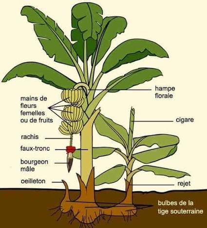
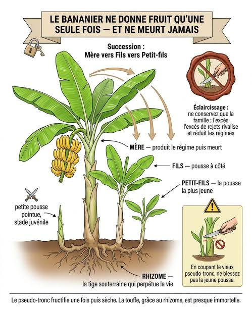
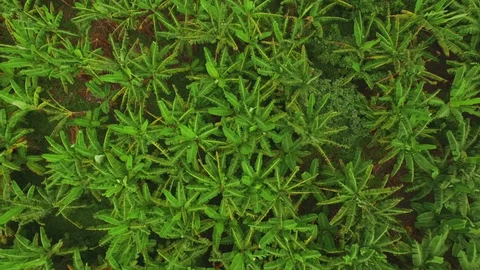
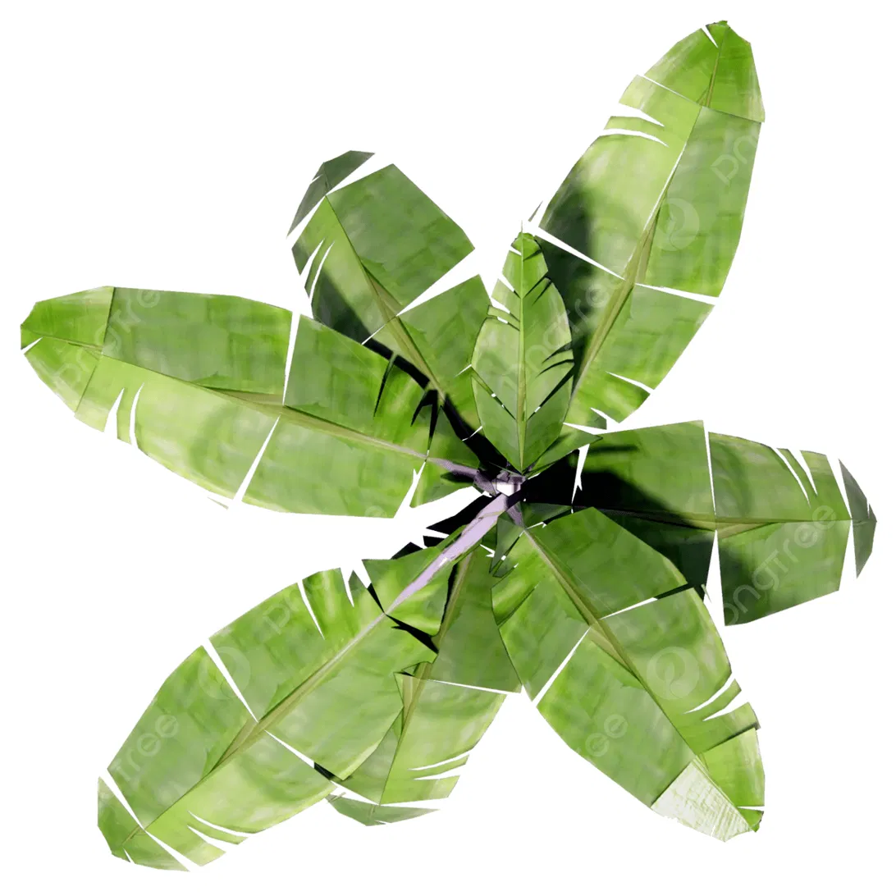
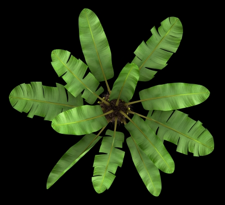
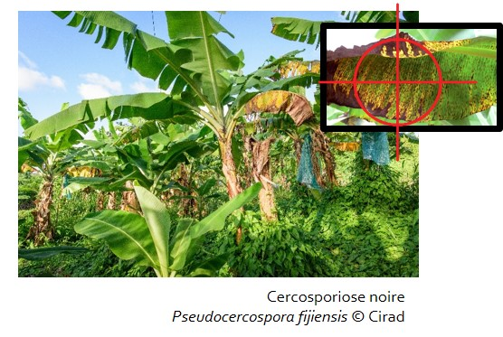
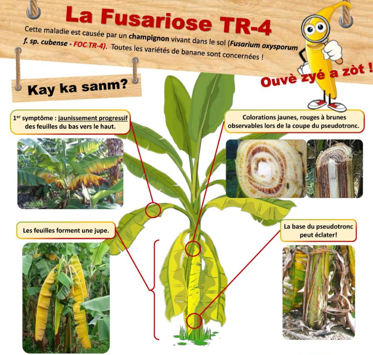

# Comprendre le bananier

Note de travail du 21 octobre 2026.

## La plante

Le bananier est une herbe géante, pas un arbre : son pseudo-tronc est fait de gaines de feuilles emboîtées. La vraie tige, le bulbe, est sous terre et produit les rejets.

## Cycle et succession

Chaque pseudo-tronc donne un seul régime, puis il est coupé. Le bulbe continue grâce à un rejet que le planteur choisit de garder (l'œilletonnage). Au même endroit, on trouve donc souvent trois générations : la mère, son fils et son petit-fils. Pour la Cavendish, un cycle dure environ 9 à 12 mois, ordre de grandeur de mémoire à vérifier avant de le citer.

## Ce que voit le drone

Vu du ciel, un bananier est une étoile de grandes feuilles. Ce qu'on doit localiser, c'est son centre, là où sort le pseudo-tronc.

| Une plantation vue du ciel | Un autre pied vu du ciel |
| --- | --- |
|  |   |

- **Les couronnes se chevauchent** : pieds espacés d'environ 2 m, feuilles de 2 à 3 m.
- **Les rangs dérivent** avec les générations (la « canopée dense dès la troisième génération » du sujet).
- **Les tailles varient** : grandes couronnes, petites, et trous là où un pied vient d'être récolté.
- **Les rejets sont cachés** sous le feuillage de leur mère.

Le jury apparie les détections aux vrais pieds avec 1 m de tolérance, soit environ la moitié de l'espacement entre deux pieds.

## Les maladies

Les images de feuilles du sujet sont prises au sol et de près, pas par drone. Les photos de cette section sont de ce type, et ne montrent pas ce que le drone verra.

### Cercosporiose noire (Black Sigatoka)

Un champignon, la principale maladie des feuilles. Elle passe par six stades, du tiret brun-rouge de 1 à 2 mm aux grandes zones sèches. Le drone ne la voit qu'aux stades avancés ; les photos de feuilles au sol couvrent tous les stades. C'est l'écart que le sujet demande de documenter.

### Fusariose (maladie de Panama, souche TR4)

Un champignon du sol. Pas de taches : les vieilles feuilles jaunissent depuis le bord et flétrissent. Peut-être visible au drone par le flétrissement de la couronne.

### Autres

Cercosporiose jaune, Cordana, Pestalotiopsis : taches sur les feuilles, peu visibles au drone.

Ces descriptions sont écrites de mémoire : à vérifier dans les fiches du Cirad ou de ProMusa avant de les citer.

## Conséquences pour Field Scan

- **Comptage** : on détecte un centre de couronne ; les rejets cachés et les couronnes fusionnées sont les pièges.
- **Vigueur** : une parcelle mélange des pieds de tous âges et des trous. Il faut comparer chaque zone au reste de sa parcelle, pas à une valeur fixe de NDVI.
- **Maladies** : modèle entraîné sur des feuilles au sol, mais drone limité aux stades avancés.
- **Faux positifs** : les vieilles feuilles jaunissent naturellement et peuvent être confondues avec une maladie.
